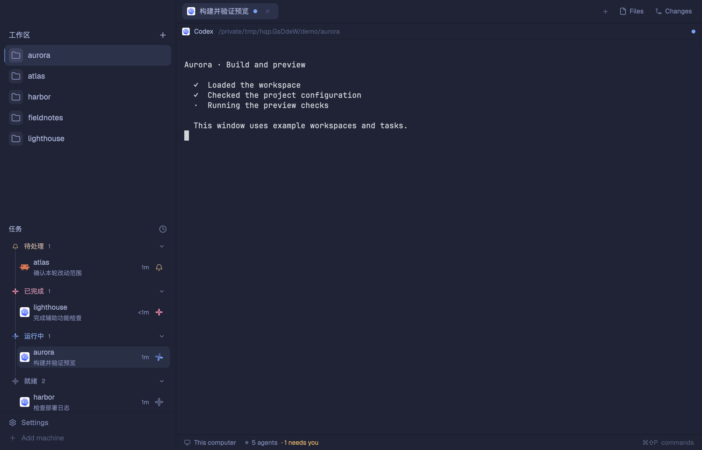
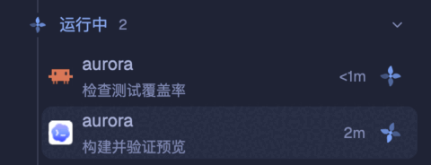

# Herdr Quiet Focus · Pinwheel

**Designed by ziheng · 作者 ziheng**

A Herdr App layout for keeping track of several coding agents. Find the project first, read the task second, and spot the agent you're following by its spinning pinwheel.

一个用于多任务协作的 Herdr App 布局。先确认哪个项目在忙，再看它在做什么。正在跟进的任务，用一枚旋转风车标出来。

[中文](#中文) · [English](#english) · [Install / 安装](#install--安装) · [Gallery recipe / 投稿说明](pinwheel/RECIPE.md)



*原生 Herdr 窗口实拍，使用示例工作区与任务。 / Captured in the native Herdr App with example workspaces and tasks.*

## 中文

### 先看项目，再读任务

左侧上半部分是工作区，下半部分是任务。任务按状态分组，一条细线串起分组标题，标题旁的数字表示该组任务数，右侧箭头可以折叠分组。列表用留白区分层次，终端仍占窗口的主要空间。

每行左侧的图标表示正在使用的 Agent。**第一行用大字显示目录名**，第二行用小字显示任务标题，右侧依次是状态持续时间和状态图标。点任务切换到对应终端，悬停可看完整路径，也可把任务固定到列表顶部。标签页和终端标题栏用小点标记运行状态，把风车留给任务侧栏。

### 风车怎么读



| 看到什么 | 代表什么 |
| --- | --- |
| **蓝色风车持续旋转** | 当前选中的任务正在运行。 |
| **蓝色风车轻轻呼吸** | 后台任务仍在运行。它的亮度缓慢变化。 |
| **粉色风车静止** | 任务已完成，可以回看结果。 |
| **空心风车静止** | Agent 已就绪，等你开始下一项任务。 |
| **铃铛** | 有事项需要处理。识别到 Codex 有待回答的问题时，还会显示问题数量。 |

**转速反映近期工具活动。** 对支持的本地 Codex 会话，风车根据最近 15 秒的工具调用调整速度。记录不可用时，运行中的当前任务仍按基础速度旋转。

## English

### Project first, task second

Workspaces sit above the task list. A thin vertical rail connects the status groups, each with an icon, a task count, and a chevron to fold it. Spacing separates the groups and leaves the terminal as the main work area.

The icon on the left identifies the agent. **The project folder gets the larger first line**, with the task title below it. Time in the current state and the status icon sit on the right. Click a row to focus its terminal. Hover to see the full path or pin the task. Tabs and pane headers use small activity dots, leaving the pinwheel in the task sidebar.

### Read the pinwheel

[Watch the native motion capture](pinwheel/pinwheel-motion.gif). The background task is above, and the focused task is below.

| What you see | What it means |
| --- | --- |
| **Spinning blue pinwheel** | The focused task is running. |
| **Gently pulsing blue pinwheel** | A background task is running. Its opacity changes slowly. |
| **Still pink pinwheel** | The task is complete and its result is ready to read. |
| **Still outlined pinwheel** | The agent is ready for the next task. |
| **Bell** | The task needs attention. Detected Codex questions can also show a count. |

**Spin speed reflects recent tool activity.** For supported local Codex sessions, the focused pinwheel responds to tool calls in the last 15 seconds. If activity data is unavailable, the focused running task still spins at its base speed.

### Spin timing / 旋转节奏

| Tool calls in 15 seconds / 近 15 秒工具调用 | Time per turn / 每转耗时 |
| --- | ---: |
| 0 or unavailable / 无调用或记录不可用 | 1,100 ms |
| 1–2 | 950 ms |
| 3–5 | 800 ms |
| 6+ | 650 ms |

Adaptive speed uses Python 3, `lsof`, and a compatible local Codex activity log. / 动态转速需要 Python 3、`lsof` 和兼容的本地 Codex 活动记录。

## Install / 安装

Verified with Herdr App **0.1.17** on macOS. Run from the repository root. / 已在 macOS 上的 Herdr App **0.1.17** 验证。从仓库根目录执行。

```sh
herdr_dir="${HERDR_APP_HOME:-$HOME/.config/herdr-app}"
mkdir -p "$herdr_dir/layouts" "$herdr_dir/mods"
cp pinwheel/layouts/ziheng-pinwheel.json "$herdr_dir/layouts/"
cp -R pinwheel/mods/. "$herdr_dir/mods/"
herdr-app do layout.switch '{"name":"ziheng-pinwheel"}'
herdr-app status
```

Back to the default layout / 切回默认布局

```sh
herdr-app do layout.switch '{"name":"main"}'
```

[Build recipe and compatibility notes / 构建配方与兼容性说明](pinwheel/RECIPE.md)

<details>
<summary>Original Quiet Focus layout / 初版 Quiet Focus</summary>

The original layout for Herdr App 0.1.13 remains available via `./install.sh`. It installs `main-quiet-focus` and its five modules. Switch with `herdr-app do layout.switch '{"name":"main-quiet-focus"}'`. The [toast experiment](experimental/toast-quiet/) is separate.

面向 Herdr App 0.1.13 的初版仍可用 `./install.sh` 安装，布局名为 `main-quiet-focus`。[通知实验](experimental/toast-quiet/)单独保留。

</details>
