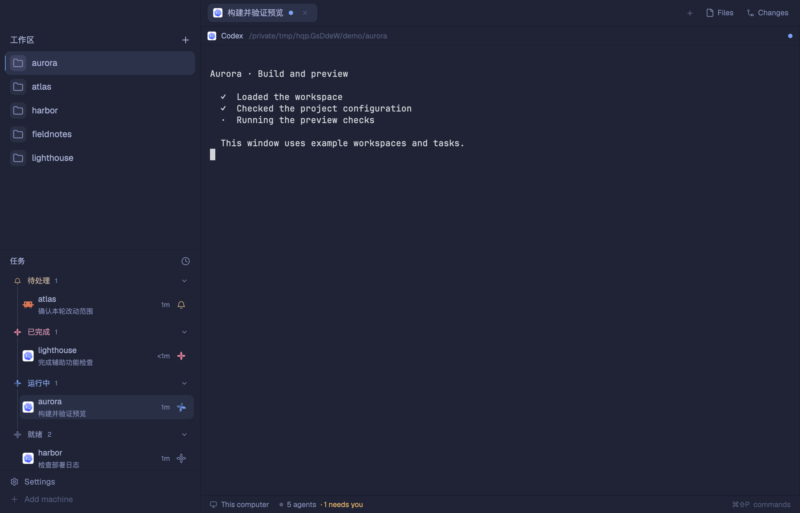
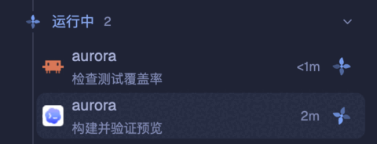

# Herdr Quiet Focus: Pinwheel

**Author: ziheng**

A dark Herdr App layout for working across several coding agents. A thin rail connects the task groups, project folders lead each row, and a four-petal pinwheel tells you which agent is working. The agent you are watching spins, background agents breathe, and finished work settles into a still pink pinwheel.

[中文设计说明](#中文设计说明)

## What you see

- A 320 px sidebar puts workspaces above tasks. A thin vertical rail connects the task headings without boxing in the rows. Headings show their status icon, name, count, and fold chevron. The selected row uses a quiet blue fill.
- Each task shows its program icon, the last component of its working directory in larger type, and the task title in smaller type below. The time and status sit on the right. Hover the text for the full directory path and title.
- The right side keeps terminal panes and tabs prominent. The layout has a slim 42 px tab bar, 30 px pane headers, and a 28 px workspace status bar. Files and Changes are available from the tab bar. The chrome uses a dark slate base with lavender text, blue activity, and pink completion. The task sidebar labels are in Simplified Chinese.

## How it behaves

**Motion carries information.** A rotating pinwheel identifies the running agent you are watching. A soft opacity pulse for background work makes it easy to pick out that one rotating task when several agents run at once. Color and shape still tell you the state when you catch a single frame.

| State | Indicator |
| --- | --- |
| Running, focused | A rotating blue pinwheel. Its default period is 1,100 ms per turn. |
| Running, in the background | A blue pinwheel with a soft 1,400 ms opacity cycle. |
| Done | A still pink pinwheel. A completed task can stay in Done while you open it to read the result. |
| Ready | A still outlined pinwheel. |
| Needs attention | A bell. When Codex has pending questions, the row can show their count and continue to indicate running work. |

For a supported local Codex session, the focused pinwheel also reflects the number of tool calls in the last 15 seconds. One call shortens the turn to 950 ms, three calls to 800 ms, and six to 650 ms. The speed returns to its default as those calls age out. It is an activity cue, so a slow turn can still mean the agent is working.

Click a task to focus its pane, hover to reveal the pin action, and click a group heading to fold it. The clock menu switches between priority and space grouping. Child agents appear beneath their parent and can be peeked separately. Tabs and pane headers use small activity dots so the main pinwheel remains easy to spot.

## Built from

The layout is `layouts/ziheng-pinwheel.json`. Its left column contains the chrome header, a split workspace and task list, and a footer. Its right column contains tabs, the active terminal with pane headers, a hidden-by-default Files/Changes stack, and the built-in workspace status bar. The palette is embedded in the layout.

- `ziheng-pinwheel-tasks` reads agents, panes, and terminals, uses native GPUI SVG rotation and opacity loops, and calls `pane.focus`, `terminal.pin`, and `terminal.peek`. It uses Herdr Core to read the current Codex screen for pending-question UI. The optional Python helper uses `lsof` to locate the focused local Codex process's active rollout and reads its recent tail for tool-call timestamps.
- `ziheng-pinwheel-spaces` lists spaces and worktrees, uses Herdr Core's machine and workspace information, and runs read-only Git commands in the relevant folders. It retains the standard workspace menu and worktree behavior.
- `ziheng-pinwheel-tabs`, `ziheng-pinwheel-pane`, and `ziheng-pinwheel-chrome` render the tab bar, pane headers, and workspace chrome. `ziheng-pinwheel-toast` hides the redundant “Codex finished” toast because the pink Done state already records completion.

## Watch out

- Verified with Herdr App 0.1.17 on macOS. This is a Herdr App layout. The rotating pinwheel uses the App's native GPUI motion API.
- Base status rendering comes from Herdr. Adaptive speed requires a focused local Codex session, Python 3, `lsof`, and an accessible compatible Codex rollout. The base rotation remains available when those conditions are absent. Pending-question detection depends on the current Codex screen format.
- The helpers process data locally through Herdr Core and the optional Python script. The package contains no session logs, machine records, account settings, or personal paths. The public preview uses example tasks. The standalone layout uses the standard terminal context menu. The author's separately installed chat extension has its own installation and configuration.

## Done when

1. The layout switches to `ziheng-pinwheel` and the six custom modules pass `herdr-app check`.
2. The task sidebar shows directory-first rows beneath the vertical status rail. Groups can be folded, and task focus and pinning still work.
3. A focused running agent rotates, a background running agent pulses, a completed task shows the still pink icon, and a ready task shows the outlined icon.

## 中文设计说明

**作者：ziheng**

看任务时，我通常先想知道「哪个项目在忙」，再看「它正在做什么」。因此侧栏把目录名放在第一行，把任务内容放在第二行。状态标题由一条细线串起来，每组保留足够的留白，滚动时容易找到下一组的起点。终端仍然占据窗口的主体。

旋转风车是我最想保留的细节。当前看的任务在运行时，蓝色风车持续旋转；其他运行中的任务只轻轻呼吸。这样同时开着多个项目，也能一眼找到自己正在跟进的那个。任务完成后，风车停下来并变成粉色；就绪用空心风车，需要回答时用铃铛。

在能读到本地 Codex 工具调用记录时，当前风车会随近 15 秒的调用频率加快，活动变少后回到原速。这个节奏表达的是最近的工具活动。即使找不到记录，Herdr 的运行状态仍然会让风车以基础速度转动。
